<a href="https://www.linkedin.com/in/younes-noufair-579ab1191/">
  <picture>
    <source media="(prefers-color-scheme: dark)" srcset="assets/card-dark.svg" />
    
  </picture>
</a>

<!-- The animated card in /assets is generated by assets/src/scene_card.py (shared toolkit: assets/src/lib.py; fonts embedded, light + dark versions). -->
