<a href="https://www.linkedin.com/in/younes-noufair-579ab1191/">
  <picture>
    <source media="(prefers-color-scheme: dark)" srcset="assets/hero-dark.svg" />
    
  </picture>
</a>

  
  
  

### 🧭 Right now

- 🚀 **Lead Software Engineer at Maxmind.ma** since 2024: I take products from the first requirement to production, and keep improving them after launch.
- 🏢 Through Maxmind, I've contributed to enterprise initiatives for **Maersk – APM Terminals**, **Checkinfo** and **Forvis Mazars**.
- 🤖 Deep into **applied AI**: building with LLMs, RAG pipelines and AI agents (LangChain, Transformers, Model Context Protocol), and turning them into features people actually use.
- 💡 I care about understanding the problem first, making the right technical decisions and building software that lasts.

 

<picture>
  <source media="(prefers-color-scheme: dark)" srcset="assets/stack-dark.svg" />
  
</picture>

  

<picture>
  <source media="(prefers-color-scheme: dark)" srcset="assets/pipeline-dark.svg" />
  
</picture>

  Got an idea? Let's make it real → <a href="https://www.linkedin.com/in/younes-noufair-579ab1191/">LinkedIn</a> · <a href="mailto:noufair97@gmail.com">noufair97@gmail.com</a>

<!-- The animated SVGs in /assets are generated by assets/src/generate.py (fonts embedded, light + dark versions). -->
